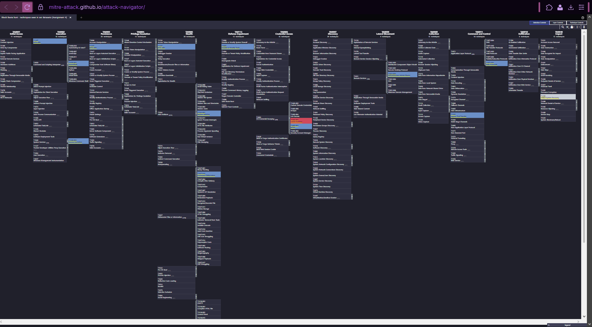

# Week 6 — ATT&CK framework (Assignment 4, part 1 of 2)

**Project:** CTI Investigation of the Black Basta Ransomware Attack Chain
**Team:** Botakoz Berikkyzy, Alina Ashirova, Timur Aktayev

Assignment 4 covers weeks 6 and 7. This is the Week 6 part. Week 7 (MITRE CAR) is in [`../week07/`](../week07/report.md).

## 1. Task and short result

The syllabus task for week 6 is: *study one specific technique (e.g., T1059)* and *simulate an attack and map the results to ATT&CK tactics and techniques*. The recommended reading is the ATT&CK Navigator documentation.

- We studied one technique in detail: **T1003.001 OS Credential Dumping: LSASS Memory**. We chose it because it connects Week 5 (our hypothesis H3) and Week 7 (the CAR analytic).
- For the "simulation" we used the recorded attacks from Week 5 (see section 4) and mapped every event we found to a tactic and a technique.
- We built a layer for the ATT&CK Navigator (`attack_navigator_layer.json`).

**Result:** the attack in our datasets uses **12 techniques from 6 tactics**. Our Week 7 analytic detects only **1 of the 12**.

## 2. Tactics, techniques, procedures (short)

From Lecture 1: a **tactic** is the attacker's goal (*why*), a **technique** is the method (*how*), and a **procedure** is the exact thing a real attacker did.

Example from our data: tactic *Credential Access* → technique *T1003.001 LSASS Memory* → procedure `rundll32.exe comsvcs.dll MiniDump` on WORKSTATION5.

**ATT&CK changed.** The Lecture 1 slide shows 14 enterprise tactics. The current version of ATT&CK (v20) has **15**: the tactic TA0005 is now called **Stealth** (it was *Defense Evasion*), and a new tactic **Defense Impairment** (TA0112) was added. Because of this, some techniques moved. For example, *Disable or Modify Tools* is now **T1685** and belongs to Defense Impairment (in Week 5 we already noted that the old ID T1562.001 was revoked). We used the current names everywhere.

## 3. The technique we studied: T1003.001 LSASS Memory

| Property | Value (from the ATT&CK page, v20) |
|---|---|
| ID / name | T1003.001, OS Credential Dumping: LSASS Memory |
| Parent technique | T1003 OS Credential Dumping |
| Tactic | Credential Access (TA0006) |
| Platform | Windows |
| Page version | 1.5, last modified 12 May 2026 |

**What it is.** After a user logs on, Windows keeps credential material (for example password hashes) in the memory of the process **LSASS** (`lsass.exe`). An attacker with administrator or SYSTEM rights can read or dump this memory and take the credentials. ATT&CK says they can then be used for lateral movement (Use Alternate Authentication Material, T1550).

**How attackers do it (examples from the ATT&CK page):**
- `procdump -ma lsass.exe lsass_dump` (a Sysinternals tool)
- Mimikatz, for example `sekurlsa::logonPasswords`
- a built-in Windows way: `rundll32.exe C:\Windows\System32\comsvcs.dll MiniDump <PID> lsass.dmp full`. This is the one in our Week 5 dataset.
- other ways: Task Manager, abusing Windows Error Reporting (`WerFault.exe`), and malicious security support provider (SSP) DLLs.

ATT&CK lists many users of this technique, including ransomware actors such as Play, Medusa, Qilin and Indrik Spider. In our project it is hypothesis H3.

**How it looks in logs:**
- Sysmon EventID 10 (a process opened `lsass.exe`) with a strong access mask such as `0x1fffff`. The ATT&CK detection strategy DET0363 describes the same idea: an unusual process opens `lsass.exe` with full access and then makes a dump.
- Sysmon EventID 1 (process creation) with the command line, for example `rundll32` + `comsvcs` + `minidump`.
- A new dump file such as `lsass*.dmp` (Elastic has a prebuilt rule for this).

**Mitigations listed by ATT&CK:**

| ID | Mitigation | Short idea |
|---|---|---|
| M1040 | Behavior Prevention on Endpoint | Windows ASR rules that protect LSASS |
| M1043 | Credential Access Protection | Credential Guard (not on by default, does not stop every method) |
| M1025 | Privileged Process Integrity | Protected Process Light for LSA |
| M1028 | Operating System Configuration | restrict NTLM, disable WDigest |
| M1027 | Password Policies | unique complex local administrator passwords |
| M1026 | Privileged Account Management | do not put admin accounts in local admin groups everywhere |
| M1017 | User Training | do not reuse passwords |

## 4. The "simulation"

We did not attack any real system. In Week 5 we used 5 recorded datasets from **OTRF Security-Datasets**: attacks that researchers ran in a Windows lab and saved as logs (24,194 events). These are recorded attack simulations, so reading and analyzing them is our way to "replay" the attack safely. One dataset is normal activity (the control set).

If a live simulation is needed, the plan for Week 9 is to run the Atomic Red Team test for T1003.001 in a lab.

## 5. Mapping the results to ATT&CK

Every row below comes from a finding of our Week 5 hunt (the full list is in `results/ttp_mapping.csv`).

| # | What we saw (host, time) | Tactic | Technique | Evidence |
|---|---|---|---|---|
| 1 | WORKSTATION6, 2020-09-20 16:16:56 (empire_psexec_dcerpc_tcp_svcctl) | Execution (TA0002) | **T1059.001** PowerShell | powershell -noP -sta -w 1 -enc ..., run as SYSTEM, parent cmd.exe |
| 2 | WORKSTATION6, same event | Stealth (TA0005) | **T1027.010** Command Obfuscation | the command is hidden in Base64 (-enc) |
| 3 | WORKSTATION6, same event | Stealth (TA0005) | **T1564.003** Hidden Window | -w 1 means the PowerShell window is hidden |
| 4 | WORKSTATION6, same time (EventID 7045 and 4697) | Execution (TA0002) | **T1569.002** Service Execution | new service 'Updater' installed, PsExec style |
| 5 | WORKSTATION6, same time | Lateral Movement (TA0008) | **T1021.002** SMB/Windows Admin Shares | remote service creation (the dataset name says DCE/RPC svcctl); best-fit mapping |
| 6 | WORKSTATION6, decoded payload | Defense Impairment (TA0112) | **T1685** Disable or Modify Tools | AMSI bypass and PowerShell Script Block Logging turned off |
| 7 | WORKSTATION6 (decoded payload) and WORKSTATION5, 2020-10-23 06:36:43 | Command and Control (TA0011) | **T1105** Ingress Tool Transfer | Net.WebClient download from http://10.10.10.5/news.php; bitsadmin /transfer from GitHub |
| 8 | WORKSTATION6, Sysmon EventID 3 | Command and Control (TA0011) | **T1071.001** Web Protocols | powershell.exe connects to 10.10.10.5:80 |
| 9 | WORKSTATION5, 2020-10-23 06:36:43 (cmd_bitsadmin_download_psh_script) | Stealth (TA0005) | **T1197** BITS Jobs | bitsadmin.exe /transfer downloads a file (v20 lists BITS Jobs under Execution, Persistence and Stealth) |
| 10 | WORKSTATION5, 2020-10-18 23:50:05 (psh_lsass_memory_dump_comsvcs) | Credential Access (TA0006) | **T1003.001** LSASS Memory (**also detected by CAR**) | comsvcs.dll MiniDump of lsass.exe; Sysmon 10 with access 0x1fffff and 0x1410 |
| 11 | WORKSTATION5, same event | Stealth (TA0005) | **T1218.011** Rundll32 | rundll32.exe starts the LSASS dump |
| 12 | DC01, 2023-07-19 19:20:48 (cmd_dumping_ntds_dit_file_volume_shadow_copy) | Credential Access (TA0006) | **T1003.003** NTDS | vssadmin create shadow /for=C: on a domain controller |
| 13 | not in our logs (CISA advisory, Week 1) | Impact (TA0040) | **T1490** Inhibit System Recovery *(not in our logs)* | Black Basta deletes shadow copies before encryption; our datasets only contain 'create shadow' |

Notes:
- One event can map to several techniques. The encoded PowerShell command in row 1 is also row 2 and row 3.
- Row 5 (lateral movement) is a best fit: the dataset name says DCE/RPC `svcctl`, and we mapped it to the usual PsExec technique.
- BITS Jobs (row 9) is listed in v20 under three tactics (Execution, Persistence and Stealth). We used Stealth because here the tool is used to fetch a file quietly.
- Row 13 is not in our logs. It comes from CISA and our Week 1 intel, and shows what our datasets do not cover.

**Summary:** 12 techniques seen, in 6 tactics: Execution, Stealth, Defense Impairment, Credential Access, Lateral Movement and Command and Control.

## 6. ATT&CK Navigator layer

The file `attack_navigator_layer.json` shows this mapping on the ATT&CK matrix.

How to open it: go to https://mitre-attack.github.io/attack-navigator/ → **Open Existing Layer** → **Upload from local** → choose `attack_navigator_layer.json`.

Colors: blue = seen in our datasets, red = seen and detected by our Week 7 analytic, grey = known from intel but not in our logs.

What the picture shows: our hunt covers many tactics, but the analytic from Week 7 detects only 1 of the 12 techniques (T1003.001). The other techniques (for example the encoded PowerShell, the new service, the downloads) need other analytics or hunts. This is the reason for Week 8, where we plan to emulate the whole chain.

## 7. What we learned and limits

1. ATT&CK is a common language. The same event can be described in a few words and matched with intel, hunts and analytics.
2. Mapping needs judgment. One event can map to several techniques, and the IDs and tactic names change between versions, so we always check the current version on attack.mitre.org.
3. Limits: the logs are recorded lab simulations, not a real victim; the mapping is our own reading of the events; one mapping (lateral movement) is only a best fit.

## 8. AI use

Claude helped us choose the technique, check the ATT&CK pages, write the script and the Navigator layer, and draft the report. We checked the technique and tactic names on attack.mitre.org and opened the layer in the Navigator ourselves.

## 9. Sources

1. MITRE ATT&CK, T1003.001 LSASS Memory (v20): https://attack.mitre.org/techniques/T1003/001/
2. MITRE ATT&CK, Enterprise tactics (v20): https://attack.mitre.org/tactics/enterprise/
3. MITRE ATT&CK, Enterprise matrix (v20): https://attack.mitre.org/matrices/enterprise/
4. MITRE ATT&CK Navigator: https://mitre-attack.github.io/attack-navigator/
5. Elastic prebuilt rule "LSASS Memory Dump Creation": https://www.elastic.co/guide/en/security/8.4/prebuilt-rule-8-3-3-lsass-memory-dump-creation.html
6. OTRF Security-Datasets (the datasets from Week 5)
7. Lecture 1 (tactics, techniques, procedures) and our Week 5 report (`../week05/report.md`)
