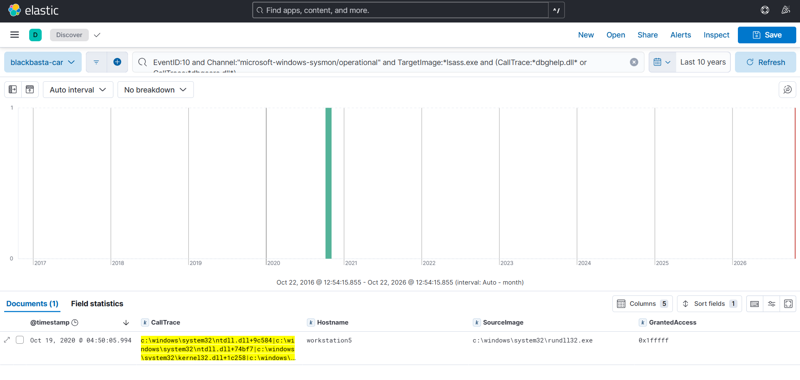
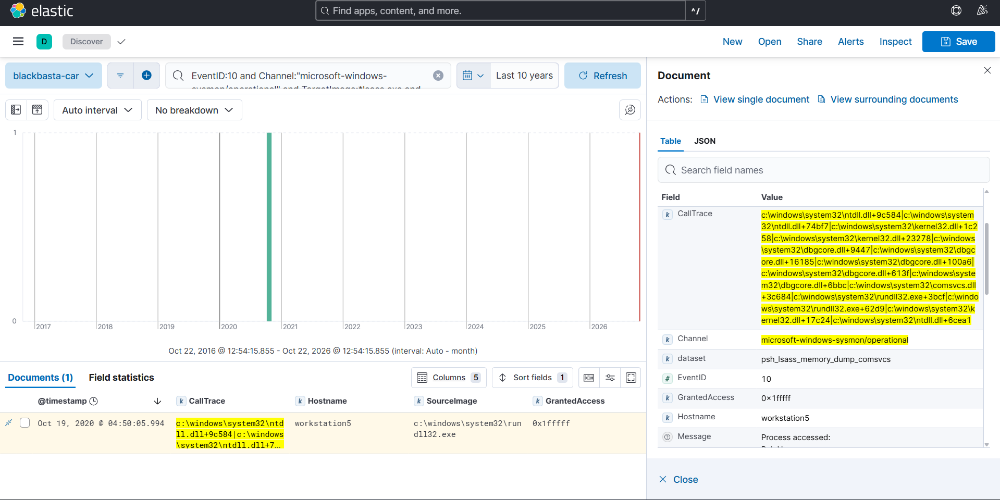
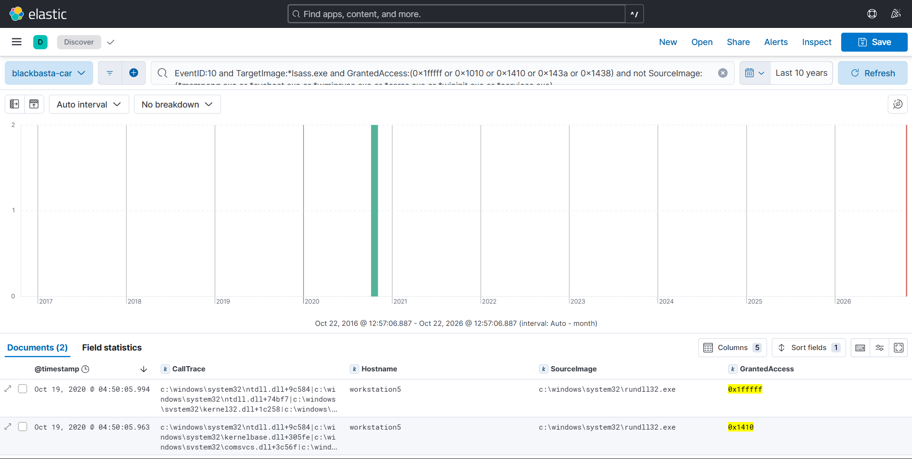

# Week 7 — Using MITRE CAR

**Project:** CTI Investigation of the Black Basta Ransomware Attack Chain
**Team:** Botakoz Berikkyzy, Alina Ashirova, Timur Aktayev

Assignment 4 covers weeks 6 and 7. This is the Week 7 part. Week 6 (ATT&CK) is in [`../week06/`](../week06/report.md): there we studied the technique T1003.001 and mapped our Week 5 findings to ATT&CK.

## 1. Task and short result

The syllabus task for week 7 is: *select an analytic model from CAR and implement it in a SIEM*, and *map the analytic to related ATT&CK techniques*.

In Week 5 we wrote our own hunt queries. This week we took a ready analytic from MITRE's repository, implemented it in ELK, tested it on our Week 5 data and compared it with our own query.

**Result:** the analytic CAR-2020-05-001 found exactly 1 LSASS memory dump in 24,194 events, with 0 false positives. It did not find the second LSASS access that our Week 5 filter found.

## 2. What is CAR, and analytic vs detection

The MITRE Cyber Analytics Repository (CAR) is a knowledge base of analytics based on the ATT&CK model. Every analytic has a description, the ATT&CK techniques it covers and implementations for tools like Splunk or LogPoint.

| | Analytic | Detection |
|---|---|---|
| What it is | The idea: what behavior to look for and why. It does not depend on one tool. | The analytic running in a real SIEM, on real logs, with tuning and an alert. |
| Example | The CAR-2020-05-001 page and its query | Our Kibana query plus an allowlist, a severity and a response step |

An analytic alone does not protect anyone. It needs the right logs, testing and tuning in the company's own environment before it becomes a detection.

## 3. Which analytic we chose and why

**CAR-2020-05-001, "MiniDump of LSASS"** (contributor: Cyber National Mission Force, submitted 2020-05-04).

| Property (from the CAR page) | Value |
|---|---|
| Type | TTP (behavior) |
| Information domain / data | Host / Process |
| Platform | Windows |
| False positives | CAR says very low in lab and production; `werfault.exe` and `tasklist.exe` showed up as false positives |

Why we chose it:

1. It fits our project. Credential theft from LSASS is our Week 5 hypothesis H3, and it comes before encryption in the attack chain.
2. It uses Sysmon EventID 10, which we already have in our datasets.
3. It is a TTP analytic (behavior), which is the top of the Pyramid of Pain, so it is more useful than IOCs.
4. We can test it: one of our datasets contains a real LSASS dump (`rundll32.exe` + `comsvcs.dll MiniDump`).

We also looked at **CAR-2021-01-009 (Detecting Shadow Copy Deletion or Resize)**, which fits Black Basta too. We did not choose it because our datasets only contain `vssadmin create shadow`, never a deletion, so we could not test it with real data. It could be tested in Week 9 with Atomic Red Team.

**How the analytic works.** When a program dumps the memory of another process with the Windows function `MiniDumpWriteDump`, the libraries `dbghelp.dll` or `dbgcore.dll` are in the call stack. Sysmon EventID 10 ("a process opened another process") has a field `CallTrace` with this stack. So the analytic looks for: EventID 10, target `lsass.exe`, and `dbghelp.dll` or `dbgcore.dll` in the `CallTrace`.

The same idea is used in practice. Elastic's prebuilt rule "Potential Credential Access via LSASS Memory Dump" also looks for `dbghelp` or `dbgcore` in the `CallTrace` of an access to `lsass.exe`, and it additionally leaves out `WerFault.exe` (the Windows crash reporter), which is a normal reason for a program to touch LSASS memory.

## 4. Implementation in ELK

- **Data:** the same 5 datasets from Week 5 (24,194 events).
- **Loader:** `elk/load_to_elk.py` loads them into a new index `blackbasta-car`. We needed a new loader because the Week 5 loader does not index the field `CallTrace`. The only change is that `CallTrace` is added to the indexed fields. The Week 5 index is not touched.
- **KQL query:**

```
EventID:10 and Channel:"microsoft-windows-sysmon/operational"
  and TargetImage:*lsass.exe
  and (CallTrace:*dbghelp.dll* or CallTrace:*dbgcore.dll*)
```

- **Original CAR query (Splunk):** `EventCode=10 TargetImage="C:\\windows\\system32\\lsass.exe" (CallTrace="*dbghelp.dll*" OR CallTrace="*dbgcore.dll*")`. We translated it to KQL; the logic is the same. We use `*lsass.exe` instead of the full path.
- **Python version:** `scripts/car_analytic.py` runs the same logic on the datasets and writes `results/car_results.csv` and `results/car_results.md`.

## 5. Results

Events scanned: **24,194**. LSASS access events (Sysmon 10): **184**. CAR analytic hits: **1**. Week 5 filter hits: **2**.

| Dataset | All events | LSASS access | CAR-2020-05-001 | Week 5 filter |
|---|---|---|---|---|
| cmd_bitsadmin_download_psh_script | 424 | 6 | 0 | 0 |
| cmd_dumping_ntds_dit_file_volume_shadow_copy | 16,843 | 168 | 0 | 0 |
| empire_psexec_dcerpc_tcp_svcctl | 4,348 | 7 | 0 | 0 |
| psh_lsass_memory_dump_comsvcs | 184 | 2 | **1** | 2 |
| psh_python_webserver (control) | 2,395 | 1 | 0 | 0 |

The two LSASS events that were found by at least one method (both on WORKSTATION5 at 2020-10-18 23:50:05 UTC, started by `rundll32.exe`):

| GrantedAccess | CAR analytic | Week 5 filter | CallTrace |
|---|---|---|---|
| 0x1fffff | **yes** | yes | has `dbgcore.dll` and `comsvcs.dll` |
| 0x1410 | no | yes | has `comsvcs.dll`, but no `dbgcore.dll` or `dbghelp.dll` |





What we see:

1. **One correct hit, no false positives.** The analytic found the real dump. The other 183 LSASS events (for example `svchost.exe` with access `0x1000`) have no `dbgcore.dll` or `dbghelp.dll` in the call trace, so they stay quiet. The control dataset also gave 0 hits.
2. **It missed the second event.** The second event of the same dump (`0x1410`) has `comsvcs.dll` in the trace but not the two libraries, so the CAR query does not see it. The attack is still detected because the main event (`0x1fffff`) matches.
3. **Two ways to look at the same attack.** CAR looks at *how* the dump is made (the code path), and our Week 5 filter looks at *what rights* the process asked for (the access mask). The CAR page says it left the access-mask filter out because it did not remove false positives and can be evaded. In our small data, both ways found the attack. Using both together is stronger.
4. **It covers only one variant.** The CAR page says that not all options of the dumping tools result in this behavior. Other ways to read LSASS memory are not covered. CAR itself rates the coverage as "Low".
5. **It needs the right logs.** The analytic only works if Sysmon is configured to log process access (EventID 10) for `lsass.exe`.

## 6. Mapping to ATT&CK

| Source | Tactic | Technique | Sub-technique | Comment |
|---|---|---|---|---|
| CAR page table | TA0006 Credential Access | T1003 OS Credential Dumping | T1003.003 NTDS | Level of coverage: Low |
| Our mapping | TA0006 Credential Access | T1003 OS Credential Dumping | **T1003.001 LSASS Memory** | The analytic detects access to `lsass.exe` with `MiniDumpWriteDump`. The ATT&CK page for T1003.001 (v20) also lists it under Credential Access. |
| Related, seen in our hit | TA0005 Stealth | T1218.011 Rundll32 | | `rundll32.exe` started the dump. This analytic does not detect it; our Week 5 H3 hunt found it |

The CAR table lists the NTDS sub-technique (T1003.003), but the text of the analytic is about dumping the memory of `lsass.exe`. NTDS is the domain controller database, which is a different case (our Week 5 `vssadmin create shadow` hit). We could not explain this entry, so we mapped the analytic by what it really does: T1003.001.

Note on tactic names: in the current ATT&CK version (v20) the tactic TA0005 is called Stealth (it was Defense Evasion in older versions and in the Lecture 1 slide). More about this and the full mapping of our findings is in the Week 6 report.

In our Kill Chain table from Week 4/5, this belongs to stage 7, actions on objectives, as in Week 5 (hypothesis H3).

## 7. From analytic to detection (what we would do in a real company)

1. Make the KQL query a Kibana alert rule that runs every few minutes, with high severity.
2. Add an allowlist after testing in our own environment. CAR names `werfault.exe` and `tasklist.exe` as known false positives, and Elastic's similar rule leaves out `WerFault.exe`.
3. Check that Sysmon logs EventID 10 for `lsass.exe`.
4. Write the response: isolate the host, reset the passwords of the accounts used on it.
5. Test it with Atomic Red Team (technique T1003.001) in Week 9.
6. Use it together with the Week 5 access-mask query to cover more variants.

## 8. Limits

- These are lab logs and the datasets are small. We have one true positive, so we cannot measure a real false-positive rate.
- We tested on the same data we used to choose the analytic.
- The analytic covers only the MiniDump variant of LSASS dumping.

## 9. AI use

Claude helped us find the CAR analytic, write the script and the queries, and draft the report. We ran the script and the Kibana queries ourselves and checked the results and the ATT&CK mapping against the CAR page.

## 10. Sources

1. MITRE CAR, CAR-2020-05-001: https://car.mitre.org/analytics/CAR-2020-05-001/
2. MITRE CAR, CAR-2021-01-009: https://car.mitre.org/analytics/CAR-2021-01-009/
3. MITRE ATT&CK, T1003 OS Credential Dumping: https://attack.mitre.org/techniques/T1003/
4. OTRF Security-Datasets (the datasets from Week 5)
5. Elastic prebuilt rule "Potential Credential Access via LSASS Memory Dump": https://www.elastic.co/guide/en/security/8.7/potential-credential-access-via-lsass-memory-dump.html
6. Our Week 5 report and scripts (`week05/`) and Week 6 report (`week06/`)
