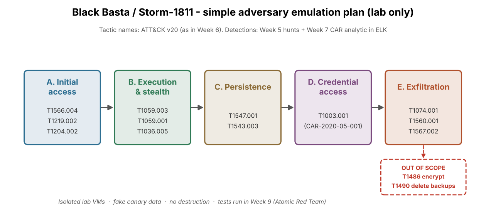

# Week 8 — Creating a Plan to Emulate an Attacker's Action (Assignment 5)

**Project:** CTI Investigation of the Black Basta Ransomware Attack Chain
**Team:** Botakoz Berikkyzy, Alina Ashirova, Timur Aktayev

## Task (from the syllabus, week 8)

1. Develop a simple adversary emulation plan (initial access → persistence → data exfiltration).
2. Document the plan using ATT&CK techniques.

Recommended reading: MITRE CALDERA documentation.

## What we did

We wrote a safe, lab-only emulation plan of the Black Basta / Storm-1811 attack chain (2024).
Every step has an ATT&CK technique, a safe lab version, and the log that should detect it
(our Week 5 hunts and the Week 7 CAR analytic). Encryption and backup deletion are out of scope.

| Item | Result |
|---|---|
| Phases | 5 (A Initial access, B Execution & stealth, C Persistence, D Credential access, E Exfiltration) |
| Techniques in the plan | 12 (plus 3 out of scope: T1486, T1490, T1485) |
| Steps we must detect | B2, C2, D1, E3 |
| When we run it | Week 9, with Atomic Red Team, results in ELK |

This week is only the **plan**. We do not run the attack yet, so there are no ELK screenshots this week.
They come in Week 9.

## Files

| Path | What it is |
|---|---|
| [`emulation-plan.md`](emulation-plan.md) | The emulation plan (the report) |
| [`images/emulation_flow.png`](images/emulation_flow.png) | Diagram of the plan |
| [`scripts/make_flow.py`](scripts/make_flow.py) | Draws the diagram |

## How to repeat

```
cd week08/scripts
python3 make_flow.py
```

(On Windows write `python` instead of `python3`. Needs `matplotlib`.)


