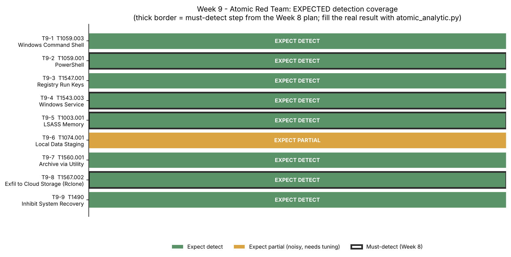

# Week 9 — Atomic Red Team (Assignment 6, part 1 of 2)

**Project:** CTI Investigation of the Black Basta Ransomware Attack Chain
**Team:** Botakoz Berikkyzy, Alina Ashirova, Timur Aktayev

Assignment 6 = weeks 9 and 10. Part 2 (Learning APT Techniques) is in [`../week10/`](../week10/README.md).

## Task (from the syllabus, week 9)

1. Run selected atomic tests (e.g. **T1059, T1003**).
2. Record and analyze the test results in a **SIEM**.

## What we did

We ran 9 Atomic Red Team tests on an isolated Windows 11 VM — the real version of our Week 8
emulation plan — exported **1,766 Windows events**, and detected each test with our own hunt
queries. The four must-detect steps from Week 8 are **B2, C2, D1, E3** (encoded PowerShell, new
service, LSASS dump, exfiltration).

| Item | Result |
|---|---|
| Atomic tests run | 9 (T1059.001/.003, T1547.001, T1543.003, T1003.001, T1074.001, T1560.001, T1567.002, T1490) |
| SIEM | Elasticsearch + Kibana 8.15.3 (same as Week 5) |
| Queries | 4 reused (Week 5 H1/H3, Week 7 CAR-2020-05-001) + 5 new |
| Result | **Must-detect 4/4**, 7/9 detected overall (1,766 events analysed) |
| Key finding | LSA Protection blocked the LSASS handle → no Sysmon 10, so the Week 7 CAR analytic did not fire; the command-line hunt still caught it |

## Files

| Path | What it is |
|---|---|
| [`report.md`](report.md) | The report |
| [`config/sysmon-week9.xml`](config/sysmon-week9.xml) | Sysmon config that logs what the queries need (incl. LSASS Event 10) |
| [`queries/atomic_detection_kql.md`](queries/atomic_detection_kql.md) | The Kibana KQL detection, one per test |
| [`scripts/atomic_analytic.py`](scripts/atomic_analytic.py) | Reads the exported logs → writes the results table |
| [`results/atomic_results.md`](results/atomic_results.md) | The real results (4/4 must-detect) |
| [`data/atomic_logs.zip`](data/atomic_logs.zip) | The 1,766 raw Windows events |
| `images/` | 6 lab screenshots + 2 coverage charts |

