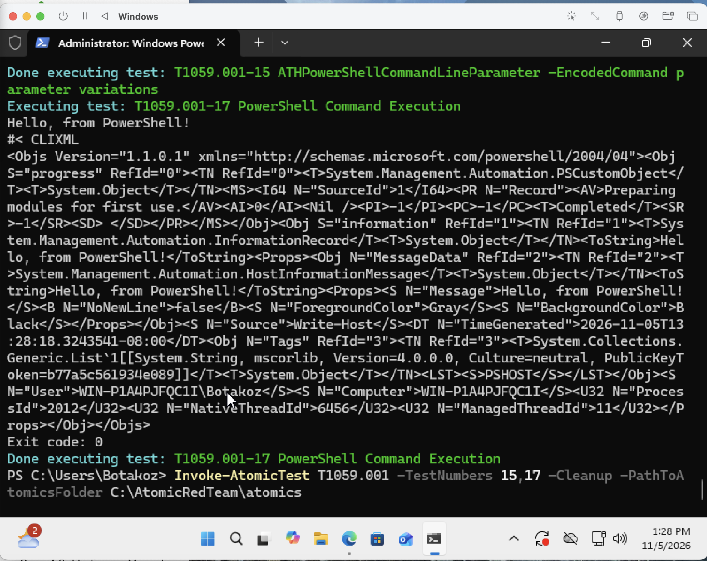
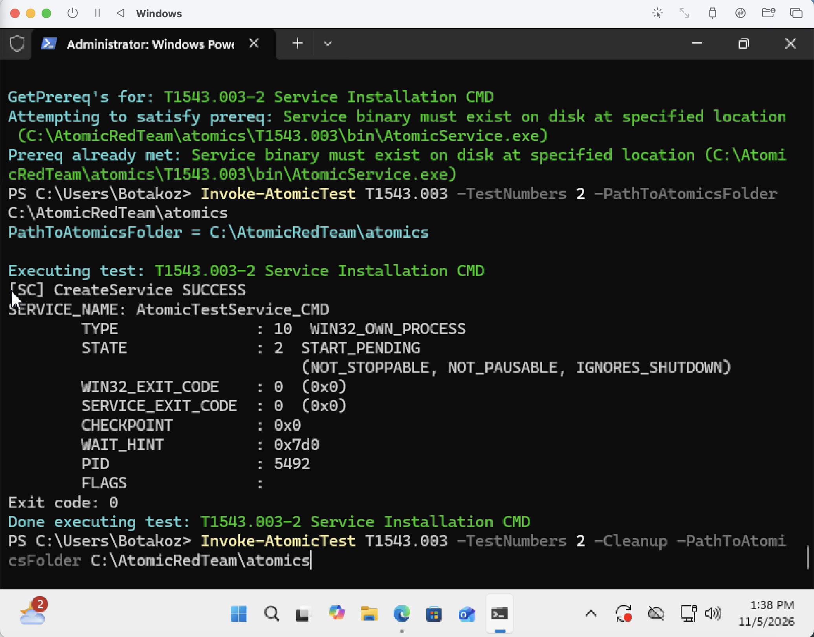
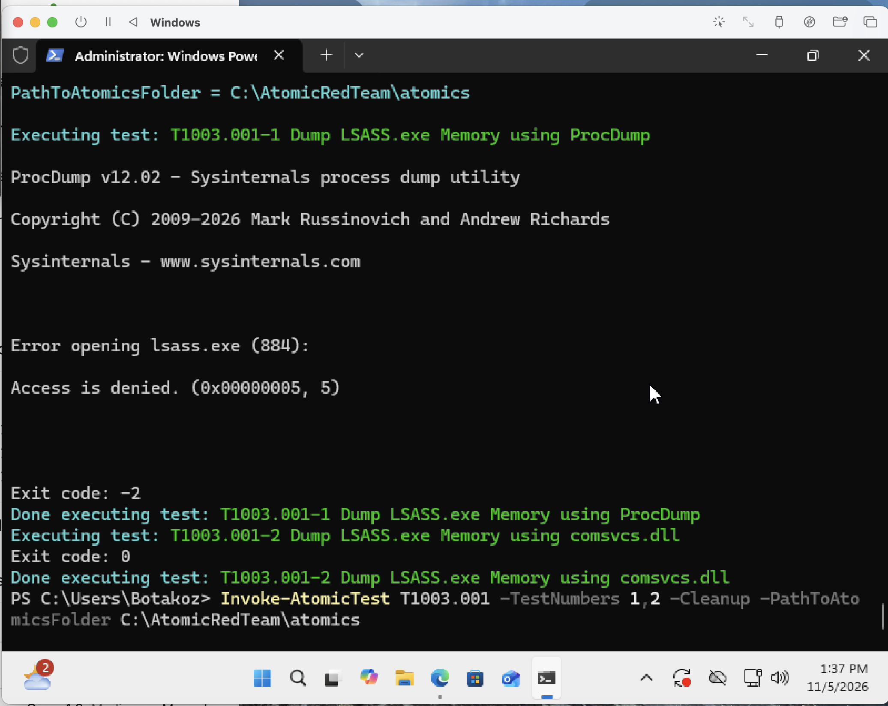
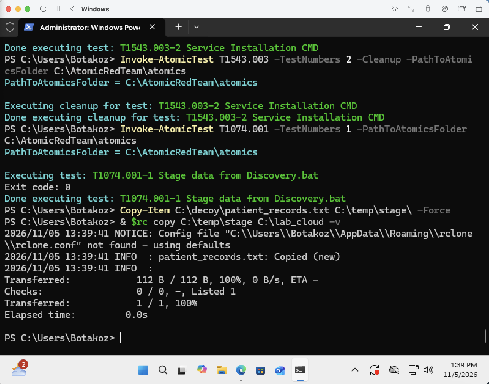
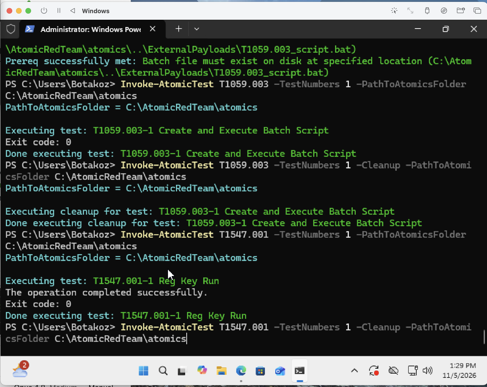
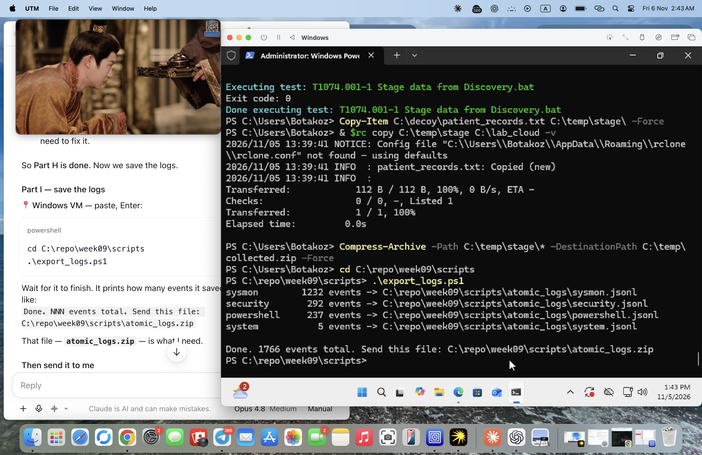
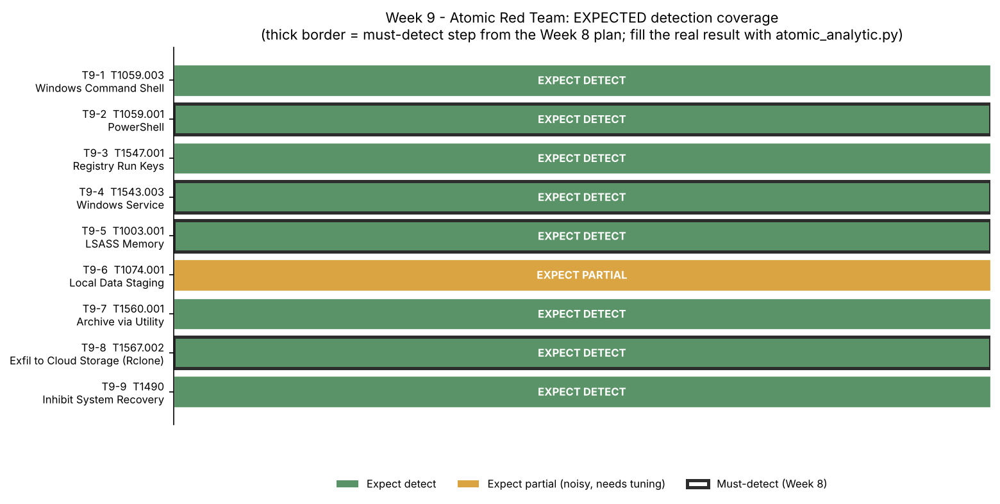

# Week 9 — Atomic Red Team (Assignment 6, part 1 of 2)

**Project:** CTI Investigation of the Black Basta Ransomware Attack Chain
**Team:** Botakoz Berikkyzy, Alina Ashirova, Timur Aktayev

Assignment 6 covers weeks 9 and 10. This is the Week 9 part. Week 10 (Learning APT Techniques) is in [`../week10/`](../week10/report.md).

## 1. Task and short result

The syllabus task for week 9 is: *run selected atomic tests (e.g., T1059, T1003)* and *record and analyze the test results in a SIEM*. Recommended reading: the Atomic Red Team wiki and GitHub repository.

In Week 8 we only **wrote** the emulation plan (with CALDERA/Atomic in mind). This week we **run** it. We executed Atomic Red Team tests on an isolated Windows 11 (ARM) VM, exported **1,766 Windows log events** (Sysmon, Security, PowerShell), and checked each test against our own hunt queries. The plan's four highest-value steps are **B2, C2, D1, E3** (encoded PowerShell, new service, LSASS dump, exfiltration); these are the "must-detect" targets from Week 8.

**Result: all four must-detect steps were detected (4/4), and 7 of the 9 tests fired in total.** The atomic tests reproduce the Black Basta behaviour on data **we generated ourselves**, and our Week 5 / Week 7 queries fire on it. One finding stands out: the LSASS dump was caught by the **command-line** hunt (Week 5 H3) but **not** by the Week 7 CAR analytic, because Windows **LSA Protection** blocked the dump and so no Sysmon Event 10 was produced — a real lesson about defence in depth and why one analytic is not enough. The per-test numbers are in [`results/atomic_results.md`](results/atomic_results.md), produced from the lab logs by [`scripts/atomic_analytic.py`](scripts/atomic_analytic.py).

## 2. What Atomic Red Team is (and how it differs from Week 8)

Atomic Red Team (by Red Canary) is a library of **small, single-technique tests**. Each test is tied to one ATT&CK technique (for example `T1003.001`) and is defined in a YAML file with the exact command, the inputs, and a cleanup command. A PowerShell framework, **Invoke-AtomicTest**, runs a test by number or GUID, fetches any tool it needs (`-GetPrereqs`), and undoes the change afterwards (`-Cleanup`).

| | Week 8 (plan) | Week 9 (run) |
|---|---|---|
| What | An emulation **plan** on paper (phases, ATT&CK IDs, safe versions) | We **execute** the atomic tests and collect real logs |
| Tool | MITRE CALDERA / Atomic Red Team (as a plan) | Atomic Red Team (`Invoke-AtomicTest`) |
| Output | The document `emulation-plan.md` | Windows event logs + detections in ELK |

An atomic test is the simplest kind of **adversary emulation**: one technique at a time, easy to repeat, easy to clean up. This is exactly what a blue team uses to answer one question — *"if this happens, does my logging see it?"*

## 3. Which tests we ran and why

Every test maps to a step of our Week 8 plan, so Week 9 is the Week 8 plan made real. We kept the two techniques named in the syllabus (**T1059** and **T1003**) as the core.

| Step | ATT&CK | Atomic test (number) | Week 8 step | Must-detect |
|---|---|---|---|---|
| T9-1 | T1059.003 Windows Command Shell | #1 Create and Execute Batch Script | B1 | |
| T9-2 | **T1059.001** PowerShell | #15 `-EncodedCommand`, #17 obfuscated IEX | B2 | ✅ |
| T9-3 | T1547.001 Registry Run Keys | #1 Reg Key Run | C1 | |
| T9-4 | T1543.003 Windows Service | #1 Service Installation | C2 | ✅ |
| T9-5 | **T1003.001** LSASS Memory | #2 comsvcs.dll MiniDump, #1 ProcDump | D1 | ✅ |
| T9-6 | T1074.001 Local Data Staging | #1 Stage data | E1 | |
| T9-7 | T1560.001 Archive via Utility | #1 Compress data | E2 | |
| T9-8 | T1567.002 Exfil to Cloud (Rclone) | Rclone to a lab endpoint | E3 | ✅ |
| T9-9 | T1490 Inhibit System Recovery | #1 Delete Volume Shadow Copies | (Week 7 future work) | |

We did **not** run T1486 (encryption). Following our Week 8 rules, where the real group would encrypt we write a marker file `EMULATION_WAS_HERE.txt` instead.

## 4. Lab setup (safe, isolated)

- One **Windows VM**, host-only network, snapshot before and after. Test account `labadmin`, canary file `C:\decoy\patient_records.txt`.
- **Logging:** Sysmon (Events 1, 3, 10, 11, 13), PowerShell Script Block Logging (4104), and Windows auditing (4688 with command line, 7045/4697 services, 4657 registry).
- **One real finding about our own Week 8 plan:** our Week 8 document says "Sysmon (SwiftOnSecurity config)". While setting up we found that the SwiftOnSecurity config **leaves the ProcessAccess section empty**, so it does **not** log Sysmon **Event 10** (a process opening `lsass.exe`). But Event 10 is exactly what our must-detect step **D1** needs (and what the Week 7 CAR analytic reads). So we built a small config, [`config/sysmon-week9.xml`](config/sysmon-week9.xml), that turns Event 10 on for `lsass.exe`, using the access masks from `olafhartong/sysmon-modular`. **Lesson: a detection is only as good as the log under it.** This is the same point we made in Week 7 ("the analytic only works if Sysmon logs EventID 10").

## 5. How we analyzed in the SIEM

We used the **same ELK stack as Week 5** (Elasticsearch + Kibana 8.15.3). The exported logs load into a `blackbasta-atomic` index so the queries can be run in Kibana.

The detection queries are in [`queries/atomic_detection_kql.md`](queries/atomic_detection_kql.md). **Four are our old queries, reused unchanged** (Week 5 H1 encoded PowerShell, Week 5 H1 service pivot, Week 5 H3 LSASS access mask, Week 7 CAR-2020-05-001 CallTrace). **Five are new** for the persistence, staging, archive, exfil and shadow-delete steps. As in Week 7, we also wrote a Python twin, [`scripts/atomic_analytic.py`](scripts/atomic_analytic.py), that runs the same logic on the exported logs and writes the results table — so the numbers do not depend on the SIEM being up.

## 6. Results

We analysed the 1,766 exported events with `scripts/atomic_analytic.py` (the same detection logic as our Kibana queries). Full table: [`results/atomic_results.md`](results/atomic_results.md).

| Step | ATT&CK | Technique | Must-detect | Hits | Detected |
|---|---|---|---|---|---|
| T9-1 | T1059.003 | Windows Command Shell | | 16 | **yes** |
| T9-2 | T1059.001 | PowerShell (encoded) | ✅ | 16 | **yes** |
| T9-3 | T1547.001 | Registry Run Key | | 1 | **yes** |
| T9-4 | T1543.003 | Windows Service | ✅ | 6 | **yes** |
| T9-5 | T1003.001 | LSASS (command-line) | ✅ | 2 | **yes** |
| T9-6 | T1074.001 | Local Data Staging | | 879 | yes (noisy) |
| T9-7 | T1560.001 | Archive via Utility | | 0 | no (see below) |
| T9-8 | T1567.002 | Exfil Rclone | ✅ | 2 | **yes** |
| T9-9 | T1490 | Shadow Copy Deletion | | 0 | not run |

**Must-detect: 4/4. Detected overall: 7/9.**

### Evidence from the lab run (screenshots)

| Step | Screenshot |
|---|---|
| T9-2 encoded PowerShell (B2) |  |
| T9-4 new service, Security 7045 (C2) |  |
| T9-5 LSASS dump (D1) |  |
| T9-8 Rclone exfil (E3) |  |
| T9-3 Registry Run key |  |
| Log export (1,766 events) |  |

What the run shows:

1. **The four must-detect steps all fire.** Encoded PowerShell (B2) shows in PowerShell 4104 and Sysmon 1 (`-EncodedCommand`); the new service (C2) shows in Security 7045 (`AtomicTestService_CMD`); the LSASS dump (D1) shows in Sysmon 1 (`rundll32 ... comsvcs.dll MiniDump` and `procdump -ma lsass.exe`); the Rclone exfil (E3) shows in Sysmon 1 (`rclone.exe copy ...`).
2. **LSASS: the command-line hunt caught what the CAR analytic missed.** On this Windows 11 VM, **LSA Protection** denied the handle to `lsass.exe`, so **no Sysmon Event 10** (process access) with a dump access-mask was produced — which means the Week 7 CAR analytic (CAR-2020-05-001, which needs Event 10 + `dbgcore.dll`/`dbghelp.dll` in the CallTrace) **did not fire**. But our Week 5 H3 **command-line** branch still detected the attempt (the `comsvcs MiniDump` and `procdump` command lines). **Lesson:** a single analytic is fragile; detecting the same behaviour two ways (the access *and* the command line) is what saved the detection here. This is exactly the point we made in Week 7 about using both together.
3. **Staging (T9-6) is very noisy — 879 hits.** The `\temp\` file-create query also catches normal Windows activity, so it is not a usable alert as written: it needs grouping by folder and a count threshold first. This is an honest detection-engineering result, not a failure, and it matches our Week 8 prediction that this step would be `partial`.
4. **Exfil went to a *local* lab folder, so Sysmon 3 (network) did not fire** — only Sysmon 1 (the `rclone.exe` process). The behaviour is detected by the process, which is the safe trade-off we chose in the Rules of Engagement.
5. **Two tests were not detected, for honest reasons.** T9-7 (archive) used a PowerShell `Compress-Archive` fallback because WinRAR was not installed; that runs in-process and does not spawn the `rar.exe`/`7z.exe` the query looks for, so it scored 0 (the real fix is to install an archiver). T9-9 (shadow-copy deletion / CAR-2021-01-009) was **not run** on this VM because we did not keep a fresh snapshot; it remains documented future work, as in Week 7.

**The loop is now closed:** Week 4 *described* the Black Basta chain, Week 5 *hunted* for it on borrowed data, Week 8 *planned* the emulation, and Week 9 *re-created the behaviour ourselves* and proved the hunts fire on data we generated.

## 7. Mapping the tests to ATT&CK

Each atomic test is already one ATT&CK technique, so the mapping is direct (ATT&CK v20 names, the Stealth / Defense Impairment names from Week 6).

| Tactic | Technique | Test |
|---|---|---|
| Execution (TA0002) | T1059.001 PowerShell, T1059.003 Windows Command Shell | T9-2, T9-1 |
| Persistence (TA0003) | T1547.001 Registry Run Keys, T1543.003 Windows Service | T9-3, T9-4 |
| Credential Access (TA0006) | T1003.001 LSASS Memory | T9-5 |
| Collection (TA0009) | T1074.001 Local Data Staging, T1560.001 Archive via Utility | T9-6, T9-7 |
| Exfiltration (TA0010) | T1567.002 Exfiltration to Cloud Storage | T9-8 |
| Impact (TA0040) | T1490 Inhibit System Recovery | T9-9 |

This is the same subset of techniques we mapped in Weeks 4 and 6, now generated on purpose and detected.

## 8. Limits

- One VM, a small run. Our detections have very few events, so we cannot measure a real false-positive rate (same limit as Weeks 5 and 7).
- The Rclone exfil (E3) goes to a **local** lab endpoint, not a real cloud, for safety. The process and network behaviour is the same, but the "cloud" is ours.
- Atomic tests are single techniques run by hand, not a full chained attack with timing. A chained run (CALDERA, or the Invoke-Atomic Adversary Emulation feature) would be the next step.
- The staging query is noisy and is not yet a production alert.

## 9. AI use

Claude helped us pick the atomic tests that match our Week 8 plan, write the Sysmon config and the Python analytic, and draft this report and the tutorial. We ran the tests, exported the logs, and took the Kibana screenshots ourselves, and we checked each test ID against the Atomic Red Team repository.

## 10. Sources

1. Red Canary — Atomic Red Team: https://github.com/redcanaryco/atomic-red-team
2. Red Canary — Invoke-AtomicRedTeam (execution framework and wiki): https://github.com/redcanaryco/invoke-atomicredteam/wiki
3. Atomic Red Team tests used: T1059.001, T1059.003, T1547.001, T1543.003, T1003.001, T1074.001, T1560.001, T1567.002, T1490.
4. MITRE ATT&CK — technique pages (v20): https://attack.mitre.org/
5. MITRE CAR — CAR-2020-05-001 and CAR-2021-01-009: https://car.mitre.org/
6. olafhartong/sysmon-modular (LSASS ProcessAccess rule): https://github.com/olafhartong/sysmon-modular
7. Our Weeks 4, 5, 7 and 8 materials.
