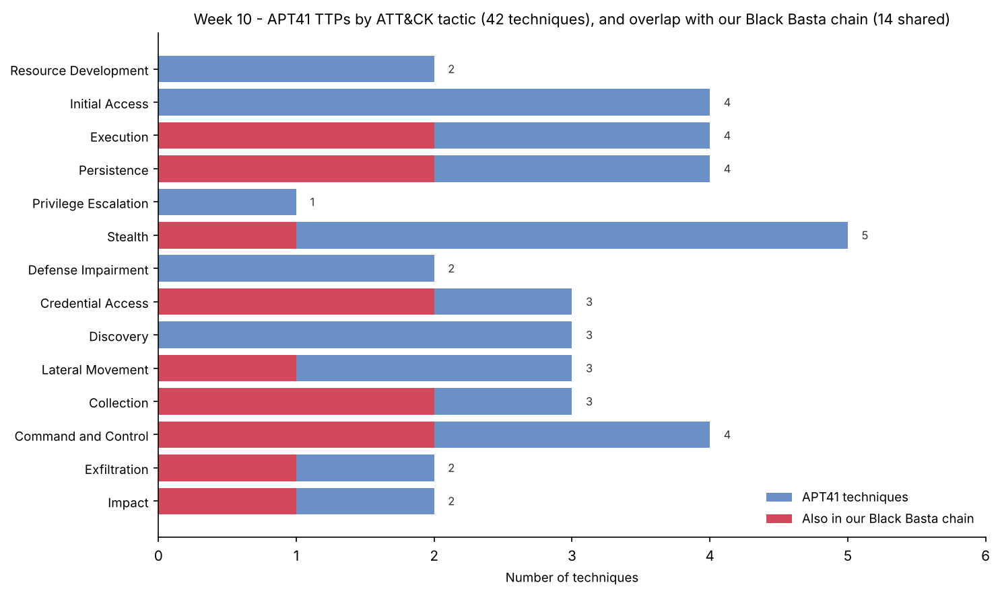

# Week 10 — Learning APT Techniques (Assignment 6, part 2 of 2)

**Project:** CTI Investigation of the Black Basta Ransomware Attack Chain
**Team:** Botakoz Berikkyzy, Alina Ashirova, Timur Aktayev

Assignment 6 = weeks 9 and 10. Part 1 (Atomic Red Team) is in [`../week09/`](../week09/README.md).

## Task (from the syllabus, week 10)

1. Analyze the TTPs of **APT29 or APT41**.
2. Map the observed techniques to the **MITRE ATT&CK** framework.

Recommended reading: Mandiant APT1 Report, CrowdStrike Global Threat Report.

## What we did

We chose **APT41** (Wicked Panda / BARIUM) — the one major APT that does both state espionage
**and** financially-motivated crime, including ransomware, so it connects this week's APT topic to
our Black Basta ransomware project. We profiled the group, listed its techniques, mapped them to
ATT&CK (v20), and compared them with the Black Basta chain from Weeks 4–9.

| Item | Result |
|---|---|
| Group | APT41 / G0096 (China; espionage + crime; active since 2012) |
| Techniques mapped | 42 across the full ATT&CK matrix |
| Shared with our Black Basta chain | **14** (our Week 5/7/9 detections already cover these) |
| APT41 signature moves | supply-chain compromise, stolen code-signing certs, bootkit, Google Calendar C2 |
| Method reference | Mandiant APT1 report (Attack Lifecycle model) |

**Main finding:** a good behaviour-based detection is not tied to one group. The detections we built
for Black Basta fire on the 14 techniques APT41 shares with it. The groups differ mostly at the
**start** (how they break in) and the **goal** (secrets vs. ransom).

## Files

| Path | What it is |
|---|---|
| [`report.md`](report.md) | The report |
| [`results/ttp_comparison.csv`](results/ttp_comparison.csv) | APT41 techniques, tactic, overlap with our chain, signature flag |
| [`attack_navigator_layer.json`](attack_navigator_layer.json) | ATT&CK Navigator layer (red = shared with our chain, gold = APT41 signature) |
| [`scripts/make_apt41_layer.py`](scripts/make_apt41_layer.py) | Builds the CSV, the layer and the chart (single source of truth) |
| `images/apt41_overlap.png` | APT41 techniques per tactic, and the overlap with our chain |

## How to repeat

```
cd week10/scripts
python3 make_apt41_layer.py      # on Windows: python make_apt41_layer.py
```

(Needs `matplotlib`.) Then open `attack_navigator_layer.json` at
https://mitre-attack.github.io/attack-navigator/ → **Open Existing Layer** → **Upload from local**.


