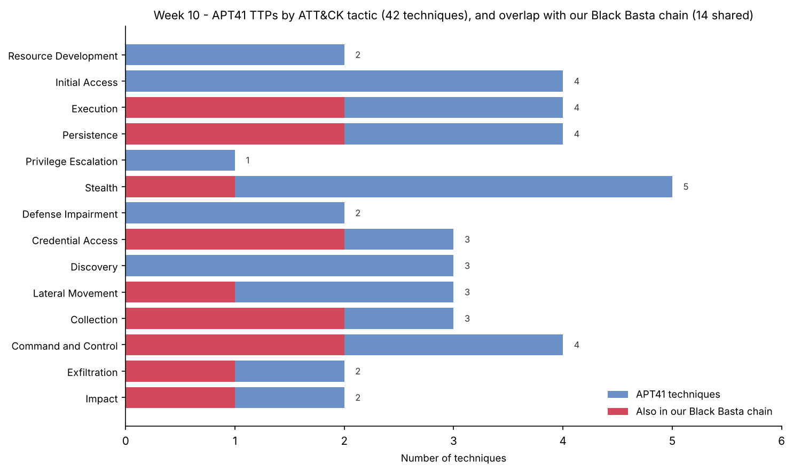

# Week 10 — Learning APT Techniques (Assignment 6, part 2 of 2)

**Project:** CTI Investigation of the Black Basta Ransomware Attack Chain
**Team:** Botakoz Berikkyzy, Alina Ashirova, Timur Aktayev

Assignment 6 covers weeks 9 and 10. This is the Week 10 part. Week 9 (Atomic Red Team) is in [`../week09/`](../week09/report.md).

## 1. Task and short result

The syllabus task for week 10 is: *analyze the TTPs of APT29 or APT41*, and *map the observed techniques to the MITRE ATT&CK framework*. Recommended reading: the Mandiant APT1 Report and the CrowdStrike Global Threat Report.

We chose **APT41**. We profile the group, list its techniques, map them to ATT&CK (v20), and compare them with the Black Basta chain we have studied all semester.

**Result:** APT41 uses **42 techniques** across the whole ATT&CK matrix (we list a representative set). **14 of them are the same techniques as in our Black Basta chain** — which means the detections we built in Weeks 5, 7 and 9 already catch part of APT41 too. The rest are APT41's own signature moves (supply-chain compromise, stolen code-signing certificates, bootkits, cloud services as C2). The full mapping is in [`results/ttp_comparison.csv`](results/ttp_comparison.csv) and the ATT&CK Navigator layer [`attack_navigator_layer.json`](attack_navigator_layer.json).

## 2. Why APT41 (and not APT29)

Our project topic is a **ransomware** chain. APT41 is the one APT group that does **both** state espionage **and** financially-motivated crime, including **ransomware**. So APT41 connects our two worlds: the APT techniques of this week and the ransomware behaviour of Weeks 1–9. APT29 (Russia's SVR) is pure espionage, so it would share less with Black Basta.

## 3. How to profile an APT — the method from the Mandiant APT1 report

The recommended reading, the **Mandiant APT1 report (2013)**, is the classic example of profiling an APT. It attributed the group "APT1" to the Chinese PLA **Unit 61398** in Shanghai, and backed it with numbers: **141 organizations** compromised since 2006 across **20 industries**, an average stay of **356 days** (longest **1,764 days**), **6.5 TB** stolen from one victim in ten months, and **937 C2 servers** on **849 IP addresses**. It also gave a model of how an APT works — the **Attack Lifecycle**:

> Initial Recon → Initial Compromise → Establish Foothold → Escalate Privileges → Internal Recon → Move Laterally → Maintain Presence → Complete Mission.

This is the same shape as the **Cyber Kill Chain** we used in Week 4, just with a loop in the middle (recon → move → maintain repeats). We use this lifecycle as the backbone to describe APT41 below. (Note: APT1 and APT41 are **different groups** — APT1 is Comment Crew / Unit 61398; APT41 is a separate, later group. We only borrow the APT1 report's *method*.)

## 4. Who APT41 is

| Property | Value |
|---|---|
| ATT&CK ID | **G0096** |
| Also called | Wicked Panda, Brass Typhoon, BARIUM, Winnti (overlaps) |
| Attribution | **China**, state-sponsored espionage **and** financially-motivated crime |
| Active since | at least **2012** |
| Reported by | FireEye/Mandiant ("APT41: A Dual Espionage and Cyber Crime Operation", 2019); Google Threat Intelligence Group (2024–2025) |
| Targets | healthcare, telecom, high-tech, finance, education, **video games**, government — 14+ countries |
| Known malware | 46+ families: China Chopper, ShadowPad, PlugX, KEYPLUG, Cobalt Strike, Winnti; and in 2025 TOUGHPROGRESS / PLUSDROP / PLUSINJECT |

APT41 is special because it mixes jobs. The Mandiant report found it ran **espionage and cybercrime at the same time, from 2014 onward** — stealing secrets for the state by day and money (game currency, crypto, ransomware) for itself at other hours. One persona's online hours (4 pm–6 am) matched the gaming attacks, which suggests members moonlighting for personal profit.

## 5. APT41 techniques, mapped to ATT&CK (v20)

We map APT41 along the lifecycle (full list in the CSV; signature moves in **bold**).

| Lifecycle stage | ATT&CK tactic | APT41 techniques (ID) |
|---|---|---|
| Initial compromise | Initial Access | Spearphishing Attachment (T1566.001); **Exploit Public-Facing App (T1190)**; **Supply Chain Compromise (T1195.002)**; External Remote Services (T1133) |
| Foothold & execution | Execution | PowerShell (T1059.001), Windows Command Shell (T1059.003), WMI (T1047), Scheduled Task (T1053.005) |
| Maintain presence | Persistence | Run Keys (T1547.001), Windows Service (T1543.003), Web Shell (T1505.003), **Bootkit (T1542.003)** |
| Escalate / hide | Priv. Esc. / Stealth | Process Injection (T1055), **DLL Side-Loading (T1574.001)**, **Code Signing (T1553.002)**, Masquerading (T1036.005), Deobfuscate (T1140), Rootkit (T1014), Modify Registry (T1112), File Deletion (T1070.004) |
| Credential theft | Credential Access | **LSASS Memory (T1003.001)**, NTDS (T1003.003), Credentials from Password Stores (T1555) |
| Internal recon | Discovery | Remote System (T1018), System Info (T1082), Domain Account (T1087.002) |
| Move laterally | Lateral Movement | SMB/Admin Shares (T1021.002), Pass the Hash (T1550.002), Lateral Tool Transfer (T1570) |
| Collect | Collection | Local Data Staging (T1074.001), Archive via Utility (T1560.001), Keylogging (T1056.001) |
| C2 | Command and Control | Web Protocols (T1071.001), Ingress Tool Transfer (T1105), **Web Service / Google Calendar C2 (T1102)**, Proxy (T1090) |
| Complete mission | Exfiltration / Impact | Exfil to Cloud (T1567.002), Exfil over C2 (T1041), **Data Encrypted for Impact / ransomware (T1486)**, Crypto-mining (T1496.001) |

**APT41 signature moves** (what makes them stand out):
1. **Supply-chain compromise (T1195.002)** — they hid malware inside legitimate software (game updates, utilities) so victims installed it themselves. They even matched target machine IDs so only chosen victims got the second-stage malware.
2. **Stolen code-signing certificates (T1553.002 / T1588.003)** — they signed their malware with real certificates so it looked trusted.
3. **Bootkit (T1542.003)** — rare for Chinese groups; hides below the operating system.
4. **Cloud as C2 (T1102)** — in 2025 their TOUGHPROGRESS malware hid commands inside **Google Calendar** events.
5. **Speed** — they rebuilt a backdoor with a new C2 domain **within hours** of being removed.

## 6. Comparison with our Black Basta chain

**What is the same (14 shared techniques).** APT41 and Black Basta both use PowerShell (T1059.001), Windows Command Shell (T1059.003), Run keys (T1547.001), Windows services (T1543.003), **LSASS dumping (T1003.001)**, NTDS (T1003.003), SMB shares (T1021.002), web-protocol C2 (T1071.001), tool download (T1105), data staging (T1074.001), archiving (T1560.001), exfil to cloud (T1567.002), masquerading (T1036.005) and, in the end, **encryption for impact (T1486)**.

**This is the key point of Week 10:** the detections we already built — Week 5 hunts (encoded PowerShell, LSASS), Week 7 CAR analytic (LSASS MiniDump), Week 9 atomic tests — **also fire on these APT41 techniques**. A good behaviour-based detection is not tied to one group. That is the whole idea of the Pyramid of Pain and ATT&CK.

**What is different.**

| | Black Basta / Storm-1811 | APT41 |
|---|---|---|
| Motive | Money (ransomware, extortion) | Espionage **and** money |
| Initial access | Social engineering: email bombing + fake IT call + Quick Assist | Supply chain, public-app exploits, spearphishing |
| Speed vs stealth | Fast, loud, days to encryption | Slow, quiet, **months to years** of access |
| Signature | Vishing help-desk trick, Rclone exfil | Supply chain, stolen certs, bootkits, cloud C2 |
| End goal | Encrypt + leak site | Steal secrets (and sometimes ransomware) |

So the two groups **share the middle of the attack** (execution, credential theft, lateral movement, exfil) but differ at the **start** (how they get in) and the **intent**. A defender who can detect the shared middle covers a lot of both.

## 7. Context: the CrowdStrike Global Threat Report (2026)

The 2026 CrowdStrike Global Threat Report (24 Feb 2026) backs up why this matters:
- The average eCrime **breakout time** (time to move from the first machine to a second) fell to about **29 minutes**, with the fastest at **27 seconds**. Defenders have very little time.
- **China-nexus** activity (the ecosystem APT41 sits in) rose **38%**, and cloud intrusions rose **37%** — matching APT41's move to cloud C2.

So the lesson of Weeks 8–10 — build and test behaviour-based detections, not just IOC lists — is exactly what the industry report asks for.

## 8. ATT&CK Navigator layer

The file [`attack_navigator_layer.json`](attack_navigator_layer.json) shows APT41 on the matrix. Open it at https://mitre-attack.github.io/attack-navigator/ → **Open Existing Layer** → **Upload from local**.

Colours: **red** = APT41 technique that is also in our Black Basta chain (we already detect it), **gold** = APT41 signature technique, **blue** = other APT41 technique.

## 9. What we learned and limits

1. **Behaviour beats indicators.** 14 techniques are shared between a criminal ransomware chain and a state APT. Detections written for one help against the other.
2. **Groups differ at the edges.** The entry method and the final goal are where APT41 and Black Basta part ways; the middle is similar.
3. **Attribution is hard and is not our job here.** The Mandiant APT1 report shows how much evidence real attribution needs. We only *describe* APT41's TTPs from public reports; we do not attribute anything new.
4. **Limits:** our technique list is a representative subset of APT41's public ATT&CK entry, not every technique. The "shared" count is measured against the chain *we* built in Weeks 4–9, so it reflects our project, not all of Black Basta.

## 10. AI use

Claude helped us gather APT41's techniques from the MITRE ATT&CK group page and public reports, build the comparison table, the Navigator layer and the chart, and draft this report. We checked every technique ID on attack.mitre.org (G0096) and read the Mandiant and Google reports ourselves.

## 11. Sources

1. MITRE ATT&CK — APT41 (G0096): https://attack.mitre.org/groups/G0096/
2. Mandiant / FireEye — *APT41: A Dual Espionage and Cyber Crime Operation* (2019): https://cloud.google.com/blog/topics/threat-intelligence/apt41-dual-espionage-and-cyber-crime-operation
3. Mandiant — *APT1: Exposing One of China's Cyber Espionage Units* (2013): https://www.mandiant.com/resources/reports/apt1-exposing-one-chinas-cyber-espionage-units
4. Google Threat Intelligence Group — APT41 using Google Calendar for C2 (TOUGHPROGRESS, 2025): https://cloud.google.com/blog/topics/threat-intelligence/
5. CrowdStrike — *2026 Global Threat Report* (24 Feb 2026): https://www.crowdstrike.com/en-us/press-releases/2026-crowdstrike-global-threat-report/
6. MITRE ATT&CK — Black Basta (S1070) and Storm-1811 (G1046): https://attack.mitre.org/software/S1070/ and https://attack.mitre.org/groups/G1046/
7. Our Weeks 4, 5, 6, 7, 8 and 9 materials.
